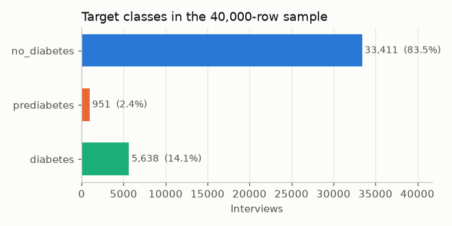
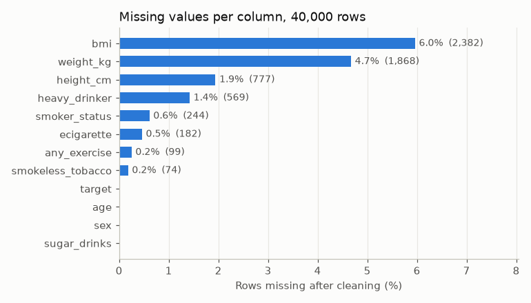
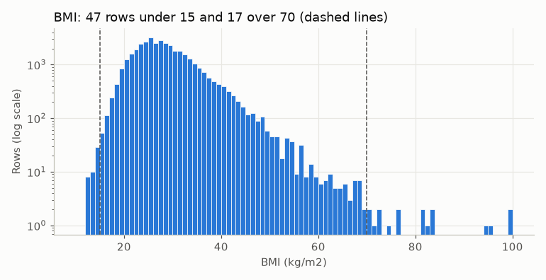

# Data quality of the 40,000-row thin table

Source: `data/processed/brfss2024_thin.parquet` (Task 3). Cleaning rules: `src/diabetes_risk/clean.py` and `src/diabetes_risk/describe.py`. Step-by-step work: [notebooks/01_cleaning.ipynb](../notebooks/01_cleaning.ipynb). Cleaned output: `data/processed/clean.csv`.

## Rows

| | Rows |
| --- | --- |
| Before cleaning | 40,000 |
| After cleaning | 40,000 |
| Deleted | 0 |
| Unlabeled (no target) | 0 |
| Labeled | 40,000 |

No row was deleted. Every interview has a target, because the contract's sample only takes `DIABETE4` codes 1, 3, and 4. Class counts match [class_counts.csv](class_counts.csv):

| Target | Interviews | Share of sample |
| --- | --- | --- |
| no_diabetes | 33,411 | 83.5% |
| prediabetes | 951 | 2.4% |
| diabetes | 5,638 | 14.1% |

Prediabetes is small. Per-class recall in Task 10 will matter more than accuracy.

## Missing values

Raw `isna()` shows only `_BMI5` (2,382) and `DIABTYPE` (39,504) as blank. Most non-answers are stored as codes (7, 9, 7777, 9999), so missingness only shows after cleaning:

| Column | Missing | Percent | Model input? |
| --- | --- | --- | --- |
| bmi | 2,382 | 6.0% | yes |
| weight_kg | 1,868 | 4.7% | no, descriptive only |
| height_cm | 777 | 1.9% | no, descriptive only |
| heavy_drinker | 569 | 1.4% | yes |
| smoker_status | 244 | 0.6% | yes |
| ecigarette | 182 | 0.5% | yes |
| any_exercise | 99 | 0.2% | yes |
| smokeless_tobacco | 74 | 0.2% | yes |
| target, age, sex, sugar_drinks | 0 | 0% | yes |

**No column is too missing to use.** 3,342 rows (8.4%) miss at least one model input. Gaps stay as `NaN`. Any imputation is fitted on the train split only, in Task 10, so it does not leak across the split.

`DIABTYPE` is 98.8% blank by design: only states that fielded the diabetes module asked it, and only of people with diabetes. It is used by Task 9, not by the model.

## Duplicates

No exact duplicates and no repeated `row_id`. Five pairs (10 rows) share every answer and the same survey weight. They are kept: `load.py` samples without replacement, so they are distinct interviews, and survey weights repeat by design (16,218 rows share their weight with another row). Their answers are common ones (no sugary soda, round heights and weights).

## Impossible or extreme values

| Column | What we found | Decision |
| --- | --- | --- |
| bmi | 47 rows under 15 and 17 over 70 (64 rows, 0.16%), up to 99.84 | Kept. Each matches its own reported height and weight (gap under 0.11), so it is not a scale error. Some look like entry errors (91 cm, 79 kg -> BMI 95) but cannot be told apart from real values. |
| sugar_drinks | 86 rows over 10 a day; 21 rows at 99 a day (code 199) | Kept. Valid codebook codes. Task 10 should consider a log or a cap before a linear model. |
| height_cm | 13 rows under 120 cm | Kept. Descriptive only. |
| weight_kg | 6 rows under 30 kg | Kept. Descriptive only. |
| age | 18 to 80 (80 means 80 or older) | No problem. |

## Other checks

- **Types:** every raw column is a numeric code. After cleaning, categories are text labels, yes/no answers are True/False, and age, BMI, sugary drinks, height, and weight are numbers. There are no dates.
- **Empty or constant columns:** none. Nothing dropped.
- **Extra spaces in text:** the raw table has no text. The cleaned labels have none.
