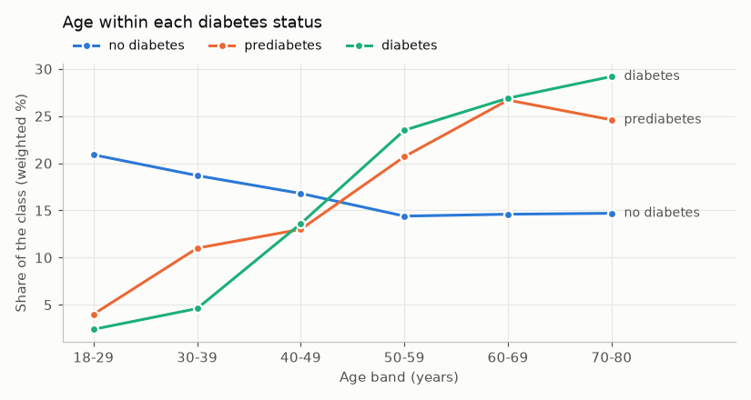
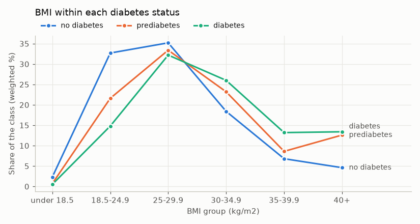
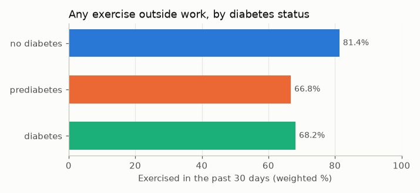
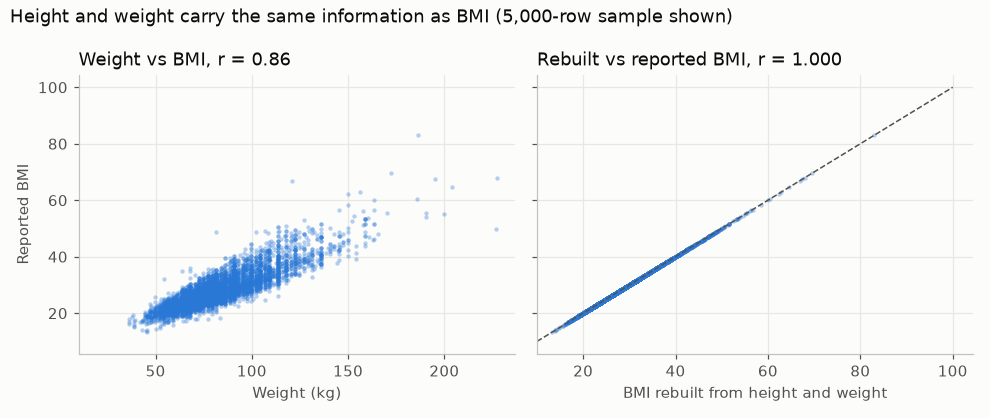

# Age, body size, and activity by diabetes status

The first half of the project question: how do age, BMI, height, weight, and physical activity differ across no diabetes, prediabetes, and diabetes? No model is fit here.

Work: [notebooks/02_relationships.ipynb](../notebooks/02_relationships.ipynb). Numbers: [relationships.csv](relationships.csv).

## How to read these numbers

Every mean and percent is weighted with the BRFSS survey weight `_LLCPWT`. The 40,000 interviews were sampled stratified on the target, and only from states that asked the sugary-soda question (see [contract.md](contract.md)). So the numbers describe each class within itself. They are not national prevalence rates, and the class sizes are not population shares. All answers are self-reported.

## Summary

| | No diabetes | Prediabetes | Diabetes |
| --- | --- | --- | --- |
| Interviews | 33,411 | 951 | 5,638 |
| Mean age (years) | 47.1 | 57.5 | 60.5 |
| Mean BMI | 27.9 | 31.0 | 31.8 |
| BMI 30 or more | 29.8% | 44.3% | 52.5% |
| Any exercise in past 30 days | 81.4% | 66.8% | 68.2% |
| Mean height (cm) | 169.9 | 167.6 | 169.7 |
| Mean weight (kg) | 80.9 | 85.6 | 91.8 |

## Age

People with diabetes or prediabetes are older. Their weighted mean age is 60.5 and 57.5 years, against 47.1 for people with neither. Only 2.4% of the diabetes class and 4.0% of the prediabetes class are 18-29, compared with 20.9% of the no-diabetes class. More than half of both diabetes classes are 60 or older (56.1% diabetes, 51.3% prediabetes), against 29.3% without diabetes.

## BMI

BMI rises from no diabetes (mean 27.9) to prediabetes (31.0) to diabetes (31.8). About half of people with diabetes (52.5%) have a BMI of 30 or more, compared with 29.8% without diabetes. A BMI of 40 or more is almost three times as common in the diabetes classes (13.4% diabetes, 12.6% prediabetes) as in the no-diabetes class (4.6%). A normal BMI (18.5-24.9) covers 32.7% of the no-diabetes class but only 14.8% of the diabetes class.

## Exercise

81.4% of people without diabetes exercised outside work in the past 30 days, against 68.2% with diabetes and 66.8% with prediabetes. Part of this gap is age, since exercise drops in the oldest band. But among people without diabetes it holds near 82-84% until age 69, while the diabetes class is lower in every band from 30 up (65-74%). Prediabetes rates by age band rest on fewer than 70 interviews per band under 40, so they are not compared here.

## Height and weight track BMI

BRFSS computes BMI from the same height and weight answers. Rebuilding BMI from `height_cm` and `weight_kg` matches the reported `_BMI5` on all 37,618 rows that have all three (correlation 1.000, largest gap 0.11). Weight alone correlates 0.86 with BMI; height alone is near zero (-0.03).

Across the classes, mean height barely moves (167.6 to 169.9 cm), while mean weight rises from 80.9 kg (no diabetes) to 85.6 kg (prediabetes) to 91.8 kg (diabetes). That is the same signal BMI already carries. This is why the model uses BMI and keeps height and weight descriptive-only: adding them would repeat BMI, not add new information.

